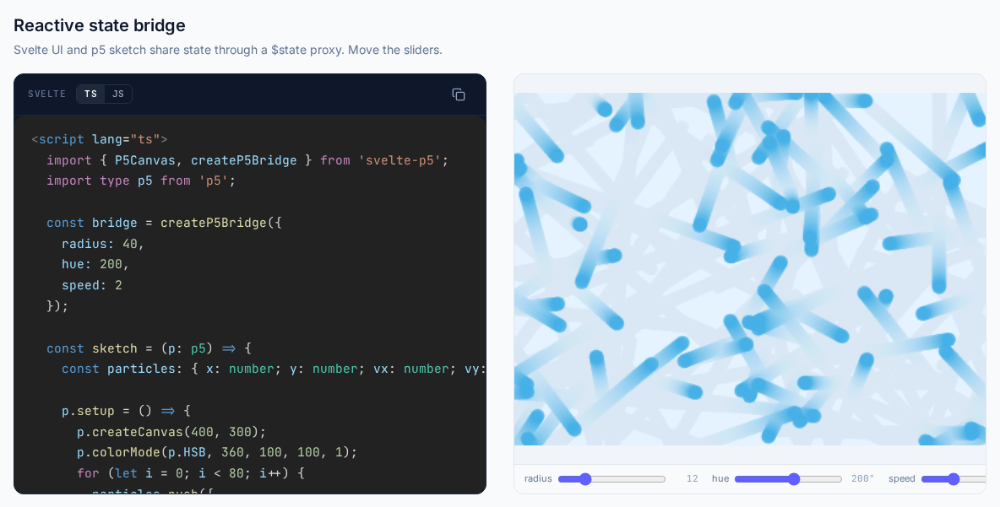

# svelte-p5

Svelte 5 bindings for p5.js: a canvas component with correct cleanup, a reactive `$state` bridge between sketch and UI, and optional pre-built components.

[](https://github.com/edw1nzhao/svelte-p5/actions/workflows/ci.yml)
[](https://www.npmjs.com/package/svelte-p5)
[](https://www.npmjs.com/package/svelte-p5-components)
[](https://www.npmjs.com/package/svelte-p5-viz)
[](https://www.npmjs.com/package/svelte-p5)
[](https://bundlejs.com/?q=svelte-p5)
[](./LICENSE)
[](https://github.com/edw1nzhao/svelte-p5/actions/workflows/ci.yml)
[](https://svelte.dev)
[](https://www.npmjs.com/package/svelte-p5?activeTab=code)

[](https://svelte-p5.dev)

**[svelte-p5.dev](https://svelte-p5.dev)** has the docs, live demos and full reference.

## Quick start

```bash
pnpm add svelte-p5 p5
```

```svelte
<script lang="ts">
	import { P5Canvas } from 'svelte-p5';
	import type p5 from 'p5';

	const sketch = (p: p5) => {
		p.setup = () => {
			p.createCanvas(400, 400);
		};
		p.draw = () => {
			p.background(240);
			p.circle(p.mouseX, p.mouseY, 40);
		};
	};
</script>

<P5Canvas {sketch} />
```

For a canvas that fills its parent and handles HiDPI, add the components package:

```bash
pnpm add svelte-p5-components
```

```svelte
<script lang="ts">
	import { Sketch } from 'svelte-p5-components';
	import type p5 from 'p5';

	const sketch = (p: p5) => {
		p.setup = () => {
			p.createCanvas(400, 400);
		};
		p.draw = () => {
			p.background(240);
			p.circle(p.mouseX, p.mouseY, 40);
		};
	};
</script>

<div style="width: 100%; height: 320px;">
	<Sketch {sketch} />
</div>
```

The [getting started guide](https://svelte-p5.dev/docs/getting-started) walks through each layer. Without a bundler, see [no build step](https://svelte-p5.dev/docs/no-build-step).

## Why svelte-p5

[`p5-svelte`](https://github.com/tonyketcham/p5-svelte) was the original Svelte wrapper for p5. svelte-p5 is a Svelte 5 rebuild with a reactive state bridge and an optional component layer on top.

|                       | `svelte-p5`                                     | `p5-svelte`                  |
| --------------------- | ----------------------------------------------- | ---------------------------- |
| Last published        | Ongoing, via release-please                     | 3.1.2, April 2022            |
| p5.js peer range      | `>=1.11.0 <3` (1.11 and 2.x, both tested in CI) | `^1.4.0` (p5 1 only)         |
| Svelte peer range     | `^5.0.0`                                        | None declared (Svelte 3 era) |
| Reactive state bridge | `createP5Bridge`, a `$state` proxy              | Not included                 |
| Pre-built components  | `svelte-p5-components`                          | Not included                 |
| npm provenance        | Yes, via trusted publishing                     | No attestation published     |

`<P5Canvas>` also calls `instance.remove()` on unmount. The [wrapper comparison](https://svelte-p5.dev/docs/perf-comparison) has the data and says when that does and does not matter. Moving over: [migration guide](https://svelte-p5.dev/docs/recipes/migration-from-p5-svelte).

## Packages

| Package                                         | Version                                                                                                                             | Contents                                                                              |
| ----------------------------------------------- | ----------------------------------------------------------------------------------------------------------------------------------- | ------------------------------------------------------------------------------------- |
| [`svelte-p5`](./packages/core)                  | [](https://www.npmjs.com/package/svelte-p5)                       | `<P5Canvas>`, `createP5Bridge`, a handful of perf utilities                           |
| [`svelte-p5-components`](./packages/components) | [](https://www.npmjs.com/package/svelte-p5-components) | `<Sketch>`, `<FPSMonitor>`, `<SketchDebug>`, `<DraggableWindow>`, `<DraggableSketch>` |
| [`svelte-p5-viz`](./packages/viz)               | [](https://www.npmjs.com/package/svelte-p5-viz)               | `VizPanel` contract, `createPanelRegistry`, `createSceneState`, `SceneConfig` types   |

`svelte-p5-viz` is below 1.0, so a caret range pins the minor. The [upgrade guide](./docs/upgrading.md) has the details for every release.

## Compatibility

- **p5.js:** 1.11+ and 2.x. CI runs every test against both, including a real-browser Playwright test.
- **Svelte:** 5, with SvelteKit.
- **Language:** TypeScript types are included.
- **License:** MIT.
- **Releases:** published to npm with provenance via trusted publishing.

## Used by

- [Interaction Geography Slicer](https://github.com/BenRydal/igs) (IGS), published at CHI 2025: Shapiro, Hall, Mathur and Zhao, [doi:10.1145/3706598.3713490](https://doi.org/10.1145/3706598.3713490)
- [Transcript Explorer](https://github.com/BenRydal/transcript-explorer)
- [Mondrian Transcription](https://github.com/BenRydal/mondrian-transcription)

## Documentation

- [Getting started](https://svelte-p5.dev/docs/getting-started), [no build step](https://svelte-p5.dev/docs/no-build-step), [three layers](https://svelte-p5.dev/docs/architecture), [state bridges](https://svelte-p5.dev/docs/bridges)
- Recipes: [shared state](https://svelte-p5.dev/docs/recipes/shared-state), [interaction](https://svelte-p5.dev/docs/recipes/interaction), [data-driven viz](https://svelte-p5.dev/docs/recipes/data-driven-viz), [cleanup](https://svelte-p5.dev/docs/recipes/cleanup), [performance](https://svelte-p5.dev/docs/recipes/performance), [HiDPI](https://svelte-p5.dev/docs/recipes/hidpi)
- [Migrating from p5-svelte](https://svelte-p5.dev/docs/recipes/migration-from-p5-svelte)
- [Upgrade guide](./docs/upgrading.md)
- Runnable [examples](./docs/examples), from a plain HTML page to a draggable dashboard

The same markdown lives in [`docs/`](./docs) for browsing on GitHub.

## Contributing

Issues and PRs are welcome; see [CONTRIBUTING](./.github/CONTRIBUTING.md). [mise](https://mise.jdx.dev/) pins node, pnpm and bun.

```bash
mise install
pnpm install
pnpm build
pnpm typecheck
pnpm lint
pnpm test
```

The site lives in [`site/`](./site) and the perf benchmark in [`bench/`](./bench). Releases are automated with release-please, and every PR gets installable preview builds from [pkg-pr-new](https://pkg.pr.new/); see [`docs/releasing.md`](./docs/releasing.md).

## Roadmap

The 1.0 API is frozen. Next is neodrag 3 stable, once upstream leaves `next`. Nothing else is committed; see [`docs/proposals/igs-port-roadmap.md`](./docs/proposals/igs-port-roadmap.md).

## License

MIT © Edwin Zhao
